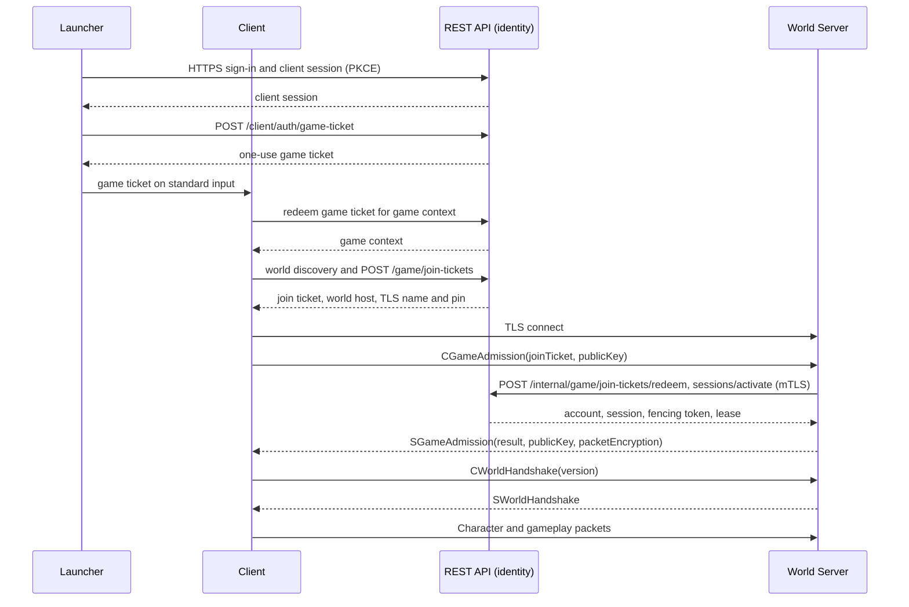

# Networking — Packet Protocol

Custom TCP layer with Protobuf-net serialization. Every client↔server message wraps a `NetworkPacket` (header + payload).

## Header Fields (`NetworkPacketHeader`)

| Field | Type | Purpose |
|---|---|---|
| `Type` (1) | `NetworkPacketType` | The opcode: which message the payload holds (e.g., `CGameAdmissionPacket` → `CMSG_GAME_ADMISSION`). The one field a packet is decoded and dispatched by |
| `Flags` (2) | `NetworkPacketFlags` | Bitmask: `None` 0, `ClearText` 1, `Handshake` 2, `Encrypted` 4. Only `Encrypted` is read: the payload is sealed with the session keys (below) |
| `Protocol` (3) | `NetworkProtocol` | `Invalid` 0, `Tcp` 1, `Udp` 2, `Both` 3. Every packet is sent as `Tcp`, and nothing reads the field |
| `Version` (4) | `int` | 0 in every header that is built, and nothing reads it. The protocol is versioned in the handshakes ([Extensibility](#extensibility)) |

The number beside each field is its protobuf field number.

The header is a struct (`NetworkPacketHeader`), read by hand from each frame by `InboundPacketFrame.ParseFrame`, so
neither a received frame nor a sent packet allocates a header (#875); the wire is unchanged.

`Encrypted` is the only flag anything acts on. A receiver opens the payload with the session keys when the header
carries the flag and takes the payload as plain when it does not (`Connection`'s read loop). A flagged payload that
does not open, or that arrives before the session has keys or on a connection that has no session (a world that does
not seal, #878), closes the connection ([failure modes](#failure-modes--safeguards)). A packet class declares
its flags in a static `Flags` field; the outbox seals a packet flagged `Encrypted` when its connection seals, and when
it does not, the payload goes plain and the flag is cleared from the header as the frame is written
([Sending a packet](#sending-a-packet)). A world with `Network:PacketEncryption` on closes a connection that sends
plain a packet it must seal ([World Admission](#world-admission)). `ClearText` is declared by the server-info,
client-info and game-admission packets (`CRequestServerInfoPacket`, `SServerInfoPacket`, `CClientInfoPacket`,
`CGameAdmissionPacket`, `SGameAdmissionPacket`) and by `CPingPacket`; `None` by `SPingPacket`, `SPongPacket`,
`CPongPacket` and `SDisconnectPacket`. The servers treat the two alike: neither is `Encrypted`. No packet declares `Handshake`. There is
no compression flag, and nothing compresses a payload. `schema/opcodes.json` lists the flags each packet class
declares.

Transport: the client signs in over the identity REST API (HTTPS), then connects directly to a world over TCP inside
TLS 1.2 or 1.3. The world uses `Hosting:Security:CertificatePath`, and the client pins the world's leaf named in its
join reply. Ordering is guaranteed by TCP.
Encryption: inside TLS, session crypto negotiated via ephemeral public key exchange during handshake stages; on the
world server the per-packet session layer is a per-world setting, `Network:PacketEncryption`, off by default (#875),
and a world with it off runs no key exchange (#878).  
Framing: a frame is a varint length prefix, then that many bytes: one protobuf `NetworkPacket` message, whose field 1
is the header and field 2 the payload, each length-delimited (a tag byte, a varint length, the bytes). No part has a
fixed length. The header is itself a protobuf message of four varint fields, and a field that is 0 is not written: the
header of a sealed gameplay packet takes 7 bytes (3 for the opcode, 2 for `Encrypted`, 2 for `Tcp`, none for the
version), and 5 when the same packet goes plain. `NetworkPacketHeader.Size`, a constant 10, is what the byte counters
add for a header, not its length on the wire: the counters are approximate, exact for a small plain packet and up to
6 bytes short for a sealed or a longer one ([instrumentation](instrumentation.md#protocol-violations)). A frame a peer
sends is limited in length
([below](#the-inbound-frame-length-limit)); a frame a server sends is not.

## The inbound frame length limit

Every frame on the wire is `[varint length][NetworkPacket{1: header, 2: payload}]`. **A frame a client sends may not
declare more than `Hosting:MaxInboundFrameSize` bytes (16,384 by default), on the world server.** The length counted is the one the prefix declares: the `NetworkPacket`'s bytes, header and payload, the
payload in the form it is sent (sealed, it carries a 12-byte nonce and a 16-byte tag); the prefix itself is not
counted.

The read loop compares the prefix before it sizes anything by it (`PacketStream.EnumerateRawFramesAsync`). A frame that
declares more than the maximum, or whose prefix is not a length (a varint that runs past five bytes; a five-byte one
carries up to 35 bits and is compared as that, never narrowed first), is not buffered and not read: nothing is rented
for it, the stream ends there, and the connection is closed without a notice, as it is when a peer goes away. This
holds before admission as after: the prefix is the first thing any peer that completes TLS sends, and the
servers used to rent a buffer of whatever size it declared. The close writes one line at Debug (the connection, its
address and the declared length), never an exception or a stack trace, and counts one in `network.in.frame_kicks` on
the server's meter ([instrumentation](instrumentation.md#refused-frames)).

Frames the servers send are not limited by it: a chunk layout or a world-state snapshot is far larger than anything a
client sends, and a client sets its own limit on what it receives.

What a client sends against the limit (client 0.2.0, measured from its code on 2026-10-13; sizes are of the whole
frame as declared):

| Frame | Largest | What bounds it |
|---|---:|---|
| `CMSG_CHAT_MESSAGE` | about 570 bytes sealed | At most 511 bytes of UTF-8, which the world enforces (#936): the chat box takes 255, and a whisper typed after `/w Name` goes out with its prefix |
| `CMSG_GAME_ADMISSION` | about 150 bytes | A 43-character ticket and a 91-byte P-256 public key, both checked for exactly that size by a world that seals; one that does not checks the ticket and does not read the key (#878) |
| `CMSG_CHARACTER_CREATE` | about 80 bytes sealed | A name of 3 to 12 letters (`CharacterName`) |
| `CMSG_PARTY_INVITE` | about 60 bytes sealed | A character's name, 3 to 12 letters, which the world checks before any lookup (#936) |
| `CMSG_WORLD_HANDSHAKE` | about 50 bytes sealed | The client's version string |
| Every other world packet | a few tens of bytes | Numbers only: no string, byte or repeated field |

So the default leaves a factor of about 28 over the largest frame a client sends, and the setting's minimum (1,024)
still admits it. No client-to-server world message has a repeated field.

## The inbound frame deadline

**A frame a peer has started must be complete within `Hosting:InboundFrameTimeoutSeconds` (10 s by default) of its first
byte, on the world server (#938).** One that is not has its read cancelled, which ends the
stream, and the connection is closed without a notice, as it is when a peer goes away. That covers a peer that starts a
frame and stops, and one that sends it a byte at a time: the clock runs from the frame's first byte and is not reset by
the bytes after it. Until #938 the read loop waited for the rest of a frame with only the server's stopping token, so
such a peer held its connection and its read buffer for as long as it liked. Like the length limit, it holds before
admission or login as after.

Only a started frame is timed. The wait between frames is not, and nothing else here closes a connection that is
connected and silent. On a world, before admission the admission timeout bounds it (15 s); after admission a silent
connection is held for as long as its admission lease lasts (#1034). TCP keepalive (`Hosting:TcpKeepAlive*`) closes no
idle connection: the peer's operating system answers its probes whatever the client does, so it only removes a peer
that has gone away without closing (a half-open connection). The first byte is the first byte the read loop receives,
inside TLS: a TLS record that never completes delivers none, and is not timed by this deadline.

The close writes one Warning (the connection, its account once it has one, its address, how many packets it had
delivered, and the deadline), never an exception or anything the peer sent, and counts one in
`network.in.protocol_kicks` with `reason` `frame_timeout` ([instrumentation](instrumentation.md#protocol-violations)),
as the read loop's other refusals do (#897, [packet handlers](packet-handlers.md)). A connection that was already
closing when the deadline expired gets neither: its close was decided for another reason (the receive queue's cap, the
admission timeout), which has its own line and count, and its socket was only waiting for the outbox to flush. A frame
that completes just as the deadline expires may be closed too: that is the deadline's edge.

The largest frame a client sends is under a kilobyte ([above](#the-inbound-frame-length-limit)), so 10 s is far more
than an honest client needs even on a poor link; there is no setting that turns the deadline off. The clock is the
connection's (on a world, the container's `TimeProvider`), so tests drive it (`PacketStreamShould`,
`InboundFrameDeadlineShould`).

**What it costs** (`PacketStream.EnumerateRawFramesAsync`). A frame that arrives whole in one read, the common case, is
never timed: it costs a comparison before the next read and a flag test after the frame, and nothing is allocated. A
frame that arrives in pieces moves one timer to its deadline and back, and allocates nothing. The timer belongs to one
cancellation source per connection, which the reads wait with once it exists; the server's stop cancels it, so a read
still ends with the stop. The source, its timer and the stop's registration are allocated once per connection, by its
first frame that arrives in pieces.

## Sending a packet

A server packet's `Create` (`S*Packet.Create`) returns an `OutboundPacket`: its header, and its message encoded, plain,
into a pooled `PayloadSegment` by `PacketEncoder` (#875). `IConnection.Send` takes the packet's payload reference. The
connection's outbox (written by its send thread) seals the payload of a packet flagged Encrypted only when
`Network:PacketEncryption` is enabled (`IOutbox.Seals`). Otherwise the payload goes plain inside TLS and the header
loses the Encrypted flag, so the client opens nothing. The outbox frames the packet with `PacketEnvelope`:
`[varint length][NetworkPacket{1: header, 2: payload}]`, written by hand, byte for byte what protobuf-net writes for a
`NetworkPacket`, then releases the segment to its pool: no `byte[]` per packet.

A broadcast whose bytes are the same for every recipient (a hit, a cast, a death, a heal, loot spawned or despawned,
instance and party chat, a party member's status, a maintenance warning) is encoded once, for the first recipient that
hears it, and each recipient takes a reference of its own (`OutboundPacket.Share`); the broadcaster releases its own
after the loop (#875). Each send thread copies the payload into its own connection's burst, sealing it there when its
connection seals, and releases its reference as it frames it, or at once when its connection refuses the packet; the
segment is never sealed in place, and it returns to its pool after the last reference. An aura update
(`SMSG_AURA_UPDATE`) is shared the same way inside the per-recipient state pass: its bytes depend only on its unit, so
the instance keeps each unit's packet for the pass (`SharedAuraUpdates`), encoded for the first recipient that hears it,
and releases its own references when the pass ends, also when it throws (#980). The world-state packets
(`SInstanceStateAdd/Update/Remove`) and the aura list stay per recipient: each recipient hears its own set of units.
An add's and an update's payload, though, is copied together from entries each encoded once per broadcast
(`SInstanceStateAddPacket.WriteEntry`, `SInstanceStateUpdatePacket.WriteEntry`, `PacketEncoder.FromPayload`): a
repeated message field is its entries one after another, and protobuf-net writes the packet's other member, the world
tick (#1066), after them, so the entries followed by the broadcast's tick, encoded once per broadcast
(`WriteTick`), are the bytes `Create` writes for the same list and tick ([world simulation](world-simulation.md)).

An instance's `SMSG_CHUNK_LAYOUT` uses the same ownership for a longer lifetime (#1130): encoded once at the end of
construction, one reference retained by the instance, and one share transferred to each arriving connection. Disposing
the instance releases only its own reference; queued sends remain valid. Failed placement disposes the unpublished
instance too. No packet is encoded or copied into a new payload segment for an arrival.

Nor a message object per packet. `Create` fills the calling thread's instance of its message type
(`PacketEncoder.Scratch<T>()`) and encodes it before it returns, so one instance per thread serves every packet of that
type. A resetter compiled once per type, at each server's startup (`PacketEncoder.PrepareServerPackets`, before
the port opens), sets every field back to a new message's value on every take and again once the message is written,
so no value of one packet reaches the next or stays referenced after it. The same call builds each type's protobuf
serializer, and those of the messages inside it, by writing the type once with something in every member (#883), so
the first packet of a type builds nothing on the tick ([packet handlers](packet-handlers.md)). A collection comes back null (protobuf-net
writes a null repeated field as it writes an empty one), so a factory assigns each collection it sends; a nested
message the template creates is shared by every thread, so a factory assigns it whole and never writes into it. A
member the reset cannot assign (a read-only field, a property without a setter) makes the type refuse to start.
`PacketEncoderScratchShould` dirties every member of every server packet and checks that the next take comes back as a
new message, and runs every factory and checks that a new thread's scratch still encodes as a new message does.

The client-to-server packets' `C*Packet.Create`, which only clients send (the load-test tool, the benchmarks and the
tests), still build a `NetworkPacket`, sealed as it is created.

## Identity sign-in

The launcher signs in through identity's HTTPS endpoints, exchanges its PKCE-bound code for a client session,
and obtains a one-use game ticket. The game client redeems that ticket for a game context, then discovers worlds
and requests a join ticket through REST. See [world entry](api-authentication.md#world-entry) for the endpoints.

The TCP auth process was retired in #1097. Its packet classes and opcodes remain in the shared wire contracts
pending a separate retirement decision; they are not a supported sign-in path or a live listener.

## World Admission

1. The client gets a join ticket from the REST API (`POST /game/join-tickets`, against its game context), bound to one
    world, character and world server, for at most 30 seconds.
2. Client opens a TCP connection to that world server and completes TLS.
3. `CGameAdmissionPacket(JoinTicket, PublicKey)` — clear text inside TLS: the ticket and a new ephemeral public key,
    which the client sends before it knows the world's mode.
4. The world server redeems the ticket and activates the session through the API's internal admission routes, off the
    tick. A world that seals then keys the session from the client's key, also off the tick, before the result reaches
    the tick; a key of the right length that is not a P-256 point is refused there with `InvalidRequest`, the lease is
    revoked and the connection closed (`bad_public_key`). A world that does not seal runs no key exchange (#878): its
    connection has no key pair and no session, and the client's key is not read.
5. `SGameAdmissionPacket(PublicKey, Result, PacketEncryption)` — `Accepted` with the world's mode (field 3,
    `Network:PacketEncryption`, #875): true, the reply carries the connection's public key and the client seals every
    gameplay packet it sends; false, TLS alone, the public key is empty and the client sends plain, keying nothing
    (a client from 0.3.0 on reads the mode before it asks for a key). The client seals exactly as told. Otherwise `InvalidRequest`,
    `AuthorizationRequired`, `ServiceUnavailable`, `UnsupportedClient` (a client too old for this world or the
    API's floor, which the join ticket already refuses 426 or 400, #1053; step 6 is the backstop) or `WorldFull` (5,
    #967: sent only by the world's player-limit backstop, over `Game:PlayerLimit` plus margin), `PacketEncryption` false, and the connection is closed
    ([when each](character-login-flow.md#sgameadmissionpacket-refusals); a world whose admission queue is full answers
    `ServiceUnavailable`, #1050).
6. `CWorldHandshakePacket(Version)` / `SWorldHandshakePacket` — sealed only when the world seals; the client's version
    must be at least the world's `MinVersion` (the REST sign-in has already required the API's floor,
    `Application:GameWorkloads:MinClientVersion`, #949). A client below it, or whose version does not parse, is
    answered `Verified` false with `Refusal` `ClientVersionTooOld` and the `MinVersion` it needs, then closed; any
    other refusal closes without a reply ([character login flow](character-login-flow.md#sworldhandshakepacket)).
7. Subsequent packets (character list, selection, movement, chat) proceed under the admitted session. A connection
    keeps the mode it was created and admitted under for its life; a change of the setting needs a restart.

Strictness of the mode (#875). With `Network:PacketEncryption` on, a plain packet the world runs (the version
handshake, and every packet a session filter names but the pong) closes the connection as a protocol violation, at
arrival, before any filter is asked (`WorldConnection.OnReceive`). Admission and pong are plain by design and accepted
plain. An opcode no world filter takes is dropped as before, whatever its flags. With the flag off a plain packet is
accepted. A frame flagged `Encrypted` whose opcode the world reads closes the connection in the read loop as a
protocol violation, counted under `sealed_before_key` (#878, [packet handlers](packet-handlers.md)): the connection has
no session to open it with, before admission or after. An opcode the world has no packet type for is dropped, whatever
its flags, before anything is opened.

Compatibility of the mode (#875, #878). A client opens a server packet by its header. A server opens a client packet
by its header while its connection has a session; a world that does not seal has none.

| Client | Server | Client to server | Server to client |
|---|---|---|---|
| 0.3.0 and later | flag off | plain; no key exchanged | plain |
| 0.3.0 and later | flag on | sealed | sealed |
| before 0.3.0 | either | refused at sign-in and at world allocation while `Application:GameWorkloads:MinClientVersion` is 0.3.0 or above (#948, #949); one that reached a world with the flag off would seal, and be closed | |

The floor's default in the API's `appsettings.json` is 0.4.0 since #967, the first client that says goodbye
([`CMSG_LEAVE_WORLD`](#the-goodbye-cmsg_leave_world)): once a release with it is deployed, a 0.3.0 client is refused at
sign-in (400 `UNSUPPORTED_PROTOCOL`). The floor is "at or above" (#949), so the 0.4.0 client ships first, against
services whose floor is still 0.3.0.

## The goodbye: `CMSG_LEAVE_WORLD`

`CMSG_LEAVE_WORLD` (0x201F, client to server, no payload, #967) says the player quits on purpose: to the desktop, or
back to the launcher. The client sends it, sealed as any gameplay packet when the world seals, then closes the
connection. It is never sent for Change Character (`CMSG_CHARACTER_LEAVE`), which keeps the connection and the session.
Nothing answers it.

- **What it does.** The world ends the session as a `logout`, and identity releases the account's place on the world at
  once ([world player limit](world-player-limit.md#the-goodbye)). A close without it is a drop: the place is held for
  the grace (90 s), so a player who lost the connection can come back.
- **Noted as it arrives.** The read loop notes the session's end as a logout the moment the goodbye arrives
  (`WorldConnection.OnReceive`), not when the tick dispatches it: the client closes right after it, and the close's
  despawn runs on the tick before any session packet would. The first reason noted for a connection wins, so a close
  after the goodbye, the client's own or the world's, does not change it; a reason the world noted before it, as it was
  already closing the connection, stands. Noted only for an admitted connection whose version handshake was accepted
  and that maintenance has not blocked; any other drops it as it drops every gameplay packet. A plain goodbye on a world
  that seals closes the connection before it is noted (#875), a drop.
- **Its handler** (`LeaveWorldHandler`, on the tick) closes a connection the client left open, which saves and despawns
  the character as any close does.
- **Accepted in every state** by `WorldSessionFilter`, before a character and in a map ([packet handlers](packet-handlers.md)).
- **It ends only its own session.** A goodbye is the connection's own statement, read on the connection it arrives on:
  a client can release only its own place, as it could by playing on and then quitting.
- **A world from before #967's part 5** has no packet type for it: the read loop drops it, with one Warning on the
  connection (#897), and the close that follows is a drop. So a 0.4.0 client works against such a world.

## Time Sync: `SMSG_PING` and `CMSG_PONG`

A world connection's first ping is the **start burst** (#1034), right after its version handshake: one ping on the next
tick, then two more 60 ticks (about a second) apart (`WorldConnection.StartBurstFollowUps`, `StartBurstSpacingTicks`),
so the client has a measured clock offset in about two seconds. From then on the world server's tick queues it a ping
once every 300 ticks (five seconds; `WorldServer.TimeSyncTicksPeriod`, 600 before #1034), on the connection's own slot
of the period (`WorldConnection.TimeSyncSlot`), one slot after another as connections are made, so the pings are
spread over the period; the burst hands over to the slot no sooner than 60 ticks after its last ping. Until #1034 the
slot was the connection's place in the list, which moved with every removal ahead of it and could skip a turn, or under
steady churn every turn, and a connection was pinged from its first tick, before its handshake, when no pong can be let
in. Each connection keeps the tick of its next turn (`WorldConnection.NextTimeSyncTick`), the one field the tick reads
of it for the time sync, and the rest is done only on a turn (`WorldConnection.OnTimeSyncDue`): before the handshake a
turn, on the slot, is the liveness check alone, and a closing connection gets no more turns. None of this, nor the
pong's handling, is on `IWorldConnection`, the future modding surface: a script can neither send a ping, start a burst
nor answer for a client. The client answers each ping with one pong. From the exchange the
server measures the connection's network round trip (`IWorldConnection.RoundTripTime` in ticks, `Latency` in whole
milliseconds) and the offset between the two clocks, and tells the client both on the next ping. An admitted
connection that answers no ping for a minute is closed (liveness, below). The
character row and the REST API carry `Latency` as of character select (`CharacterSelectHandler` copies it once):
often a reading of the start burst, or 0. Both packets are plain inside TLS, whatever `Network:PacketEncryption` says.
Every time is in UTC ticks (100 ns, counted from year 1).

| Packet | Field | Meaning |
|---|---|---|
| `SPingPacket` | `ServerTimestamp` (1) | Server time as the connection's send thread wrote the ping (#875). It also names the ping: t1 |
| | (2) | Reserved: `ClientTimestamp`, the `ClientReceivedTimestamp` of the last accepted pong, which no client read; removed in #1034 |
| | `Rtt` (3) | The last network round trip the server measured |
| | `Offset` (4) | Server time minus client time, from that same exchange: a client adds it to its own clock to read the server's |
| | `TickMicros` (5) | The world's mean tick time in microseconds; 0, not reported (below) |
| | `WorldTick` (6) | The world's tick count as `ServerTimestamp` was read, in the same step: the anchor of the state broadcast's ticks (below) |
| | `WorldTickRate` (7) | The rate the world's loop is scheduled at, in ticks a second: 60; 0 from a server that does not send it |
| `CPongPacket` | `LastServerTimestamp` (1) | The `ServerTimestamp` of the ping it answers, echoed exactly |
| | `ClientReceivedTimestamp` (2) | When the client received the ping, on its own clock: t2 |
| | `ClientSentTimestamp` (3) | When the client sent the pong, on the same clock: t3 |

**The server times the exchange from its own clock (#892), and the client's hold from the client's (#1034).** Before
#892, the round trip was computed from the echo and the client's receive and send times, so a client could report any
round trip it liked, zero and negative ones included. Now:

- The send thread records the stamp of each ping as it writes it, before the ping can reach the client. It keeps the
  stamps of the last four pings it wrote (`ConnectionSender.PingStampCapacity`), each until a pong answers it. A
  connection has one ping unanswered at a time in steady play and three at most during the start burst (which takes
  the place of the periodic pings until it ends); the fourth place is a spare for a client slow to answer the burst.
  So a stamp stays answerable for twenty seconds at the steady cadence, and eight or more for a ping of the burst.
- **One pong per ping.** Each ping written grants the connection one pong credit, never more than four at once. A pong
  takes a credit as the read loop receives it, whatever it echoes, and a pong that finds none is dropped there
  (`WorldConnection.OnReceive`), before it is queued for the tick. The start burst's pings each grant their own credit,
  so the burst needs no allowance of its own, and a pong no ping was written for still finds none. The check comes after
  the admission check, so a pong sent before admission is dropped as it always was and spends nothing. No ping is
  written before the handshake (#1034), so a connection has no credit until its burst.
- A pong that got in is accepted only when its `LastServerTimestamp` equals one of the recorded stamps. The stamp is
  then spent. The echo plays no other part.
- The four times: t1, the ping's stamp; t2 and t3, the pong's `ClientReceivedTimestamp` and `ClientSentTimestamp`;
  t4, the pong's arrival, taken by the read loop as it reads the pong off the socket, not when the tick handles it. t1
  and t4 are the server's own readings of its own clock, so `t4 - t1` is the whole round trip, the client's hold of
  the ping (`t3 - t2`) included.
- `network round trip = (t4 - t1) - (t3 - t2)`, the whole round trip less the client's hold. `RoundTripTime` and the
  ping's `Rtt` are it, and `Latency` is it in whole milliseconds.
- `offset = ((t1 - t2) + (t4 - t3)) / 2`, which is `t1 + network round trip / 2 - t2`: the server's time half a
  network round trip after its stamp, less the client's when it received the ping. It is server time minus client
  time, the sign the client applies (`NowTicks() + ClockOffsetTicks()` is server time), and the client's hold no longer
  biases it by half the hold. The client's times are its own clock by nature, and false ones move only that client's
  own idea of server time.
- **A hold that cannot be true is ignored**: one that is negative (`t3 < t2`) or longer than the whole round trip.
  The server then uses `t4 - t1` as the network round trip and in the offset, as before #1034, so a client's garbage
  can never make the round trip negative or move the offset by more than half the round trip. The two client times
  are compared without a signed subtraction, so no pair of far-apart values wraps round into a hold that looks valid.
- The next ping carries `Rtt` and `Offset` from the last accepted pong. Both are 0, as are `Latency` and
  `RoundTripTime`, until the first one.

**Liveness: a minute without an answer (#1034).** An admitted connection (one whose admission published a game
session lease) that has had no pong the server accepts as answering one of its pings (the echo of a stamp the record
holds, as above, arriving no earlier than that stamp) for `WorldConnection.LivenessTimeout`, 60 seconds, is closed. The
minute is counted from the admission, so a client that never answers is closed too, and starts again at each answer. A
pong that answers nothing (a forged echo, an answer already given, one dropped for want of a credit) does not reset it.
The client answers every ping in every state (loading, menus, minimised), so twelve periodic pings in a row unanswered
is a client that is dead, stuck or hostile, and a peer that trickles a TLS record (which the frame deadline cannot see)
cannot produce answers. The check rides the time-sync sweep (`WorldConnection.CloseIfSilent`, asked first on each of the
connection's turns, once a period, at the tick's time), so a connection is closed within five seconds of its minute, instead
of being pinged again. The close is the one a disconnect takes (`Close` then `OnClose`): the next tick ends the
session, saves the character and releases the lease. No notice is sent. Counted in `network.in.silent_kicks`
([instrumentation](instrumentation.md#silent-connections)), and logged at Information at most once per ten seconds for
the world, with the number held back. A connection not yet admitted is the admission timeout's (15 s), and one
maintenance has blocked drops every packet, its pongs too, and is closed by maintenance.

**The world's tick time (#1016).** `TickMicros` is for a client's performance overlay, so a player can tell a slow
server from a slow connection. It is the mean busy time of the world's whole ticks, from a tick's start to its end
without the wait for the next one (what `world.tick.duration` times, [instrumentation](instrumentation.md#tick-and-instance-time)),
over the ticks that ended in the last completed window of about one second, rounded to whole microseconds. It is one
figure for the whole world, the same in every connection's ping, not the character's instance: instances tick one
after another inside the world's tick, so a quiet instance in a busy world still waits for the whole tick, and the
whole tick is what the 60 Hz budget (16,667 µs, a constant on both ends) holds. It is measured on every tick from the
two timestamps the tick already takes for its own histogram, not only under tracing; the tick queues the ping with the
figure it holds, which is at most one window old. **0 means not reported**: no window has closed yet (the ping queued
on a world's first second, the handshake ping of a world that just started), or a server from before this field; a
measured mean is never 0. A client keeps its dash for 0. The field costs 2 to 4 bytes per ping for any mean under
2.1 s (2,000 µs is 3 bytes, 16,667 µs is 4), 5 or 6 bytes for a stall longer than that, and nothing when 0.

**The world's tick, and its anchor (#1066).** Every `SInstanceStateAddPacket` and `SInstanceStateUpdatePacket` carries
`WorldTick` (field 2): the number of the world loop's tick that built it, the first being 0. It is the world's count
of completed ticks (`WorldServer.CompletedTicks`, kept in `WorldTicks`), read once per instance as its broadcast
begins, after the tick's simulation; the count moves on as the tick ends. One field per packet, not per object: every
object in a packet was simulated in that tick. So a client can tell which step a position belongs to, and, since the
count is exact and moves by one, a gap or a duplicate. The ping's `WorldTick` is the same count, read by the send
thread in the same step as `ServerTimestamp` as it stamps the ping: the number of the tick running then, or of the
next one between ticks (so within one tick of the instant). With the ping's time, and the client's clock offset, it
turns a broadcast's tick into server time: `server time of tick T ≈ ServerTimestamp + (T - WorldTick) / WorldTickRate`.
A fresh pair comes every ping, so the client never counts forward from an old one across ticks that ran long or the
loop's resync after a stall, which leave the count short of 60 a second. `WorldTickRate` is the loop's scheduled rate
(`WorldTicks.PerSecond`, the constant the loop's period is derived from), so a client does not hard-code 60. A tick
that throws is not counted, so the tick after it carries the same number. Both fields are `int64`, the type of the
count: a varint of 1 to 5 bytes for any uptime under some eighteen years (3 bytes past 4.5 minutes, 4 past 9.7 hours,
5 past 52 days), plus the tag, which a `uint32` would match byte for byte while wrapping after 2.27 years; tick 0 is
left off the wire. Two cast packets name the same count since #1082, both `int64`: `SUnitStartCastPacket.WorldTick`
(field 7), the tick a cast was taken on, so a client ends its cast bar and telegraph countdown at that tick's server
time plus `CastTime`; and, from the client, `CCastAbilityPacket.ViewTick` (field 4), the tick its render clock was
drawing other units at when the player cast (0, not sent, rewinds nothing), the tick a player's instant cast's hits
are judged at (a projectile's sweep: that tick plus the caster's one-way delay), clamped to 15 ticks behind its own
(below, and [spell-system.md](spell-system.md) §4).

**What a client must do.** Echo `ServerTimestamp` unchanged, answer each ping once, and send no other pong: a pong
that echoes anything else uses up that ping's one answer, and the true echo sent after it is dropped. Answer every
ping, in every state, within the minute (liveness, above). Fill `ClientReceivedTimestamp` as it reads the ping and
`ClientSentTimestamp` as it sends the pong, both from the clock it applies `Offset` to: the time between them is taken
out of the round trip and the offset (#1034), so answering late costs nothing as long as the two times are true. After
a stall in which pings went unanswered, answer only the newest ones, at most four, and drop the rest: the server
remembers the last four stamps and lets at most four pongs in, whatever they echo, so an answer to an older ping
takes the place of an answer to a newer one.

**What the server drops and ignores.** In every case below `Latency`, `RoundTripTime` and the offset stay as they
were, the next ping repeats the old `Rtt` and `Offset`, the liveness minute runs on, and the connection stays open
until that minute ends. No metric counts any of them.

- *Dropped as it arrives*: a pong beyond one per ping written (a second answer, a burst, a pong before any ping). It is
  never queued and no handler runs. Logged at Trace only (`Avalon.World.WorldConnection`), since a client can send
  them at any rate. This also catches a client that stalls past four pings and then answers them all, oldest first:
  its first pongs spend the four credits on pings the record has forgotten, and the answers to its newest pings are
  dropped. With five unanswered, the newest ping's answer is the one dropped and the reading left is the one before
  it, stretched by the stall; with eight, all four pongs let in answer forgotten pings and nothing is measured. The
  next ping measures again.
- *Let in, then ignored by the handler*: a pong whose echo is the stamp of no unanswered ping (a forged or guessed
  one, the echo of a ping already answered, or of a ping that four later pings have pushed out of the record). Logged
  at Debug, at most once per ping written.
- *Let in, matched, then ignored*: a pong whose arrival reads earlier than the stamp it echoes. Either the echo was
  sent ahead of its ping (a guess that hit) or the server's clock was set back in between. The stamp is spent, nothing
  is measured, the round trip is never negative, and it is no answer to the liveness rule. Logged at Debug.

**What the measurement does not prove: `Latency` is advisory, in both directions.**

- *Guessing the stamp.* The echo is a reading of the server's clock, not a secret. A client sees every earlier
  `ServerTimestamp` and the pings follow the tick's deadlines, so it can predict the next stamp to within about 0.1 to
  2 ms: 1,000 to 20,000 candidate values at 100 ns. A pong carrying the right one, arriving just after the ping is
  written and before the client could have read it, reads a round trip shorter than the client's own. The credit
  leaves it one guess per ping against those thousands of candidates (up to four at once after letting pings go
  unanswered), where it used to have as many as it could send. That lowers the odds and does not close guessing. A
  ping identifier the client cannot predict would close it, and is a wire change.
- *Answering late* raises the reading, unless the client also reports the hold. How long a stamp stays answerable
  follows from the cadence alone (until four later pings are written, some twenty seconds at one ping per five
  seconds). Nothing in the code caps the round trip.
- *Claiming a hold* lowers it. The hold is the client's word (#1034): a client can report any hold from zero up to the
  whole round trip, and read any network round trip from the whole one down to 0. The server's own `t4 - t1` bounds it
  from above, and a hold outside that range is ignored.
- *The reading has no age.* A client that stops answering keeps its last reading until the liveness rule closes it, a
  minute on, and one that never answers reads 0.

**How lag compensation uses it (#1082): never as a bound.** Lag compensation (rules in
[spell-system.md](spell-system.md) §4) has three uses that a reading could touch, two of which read `RoundTripTime`,
and each is safe against a reading that is guessed, raised, lowered or stale, because the reading only moves a value
inside a fixed cap:

- *The view tick is the client's word, capped.* A player's instant cast is rewound to `CCastAbilityPacket.ViewTick`,
  at most 15 world ticks (250 ms) behind the present. The round trip is not read for it at all: tightening the cap
  with the round trip was considered and rejected, since a client can raise its reading. A client may always claim the
  whole cap, and that is accepted.
- *A projectile's rewind is shortened by one way of the round trip* (half of it, in whole world ticks), never below 0. A
  raised reading only shortens the client's own rewind; a lowered one at most gives back the view tick's rewind, still
  inside the cap.
- *The dodge wait holds a telegraph's hit on a player for one way of their round trip*, at most 6 world ticks (about
  100 ms). A raised reading buys at most those 6 world ticks to step out; a reading of 0 (none measured, or the client
  never answers) holds nothing, so the hit lands at once, as before.

Anything else that would trust latency (cheat heuristics, matchmaking) needs more than this. An age for the reading and
a ping identifier the client cannot predict would close staleness and guessing, and no more. A client could still raise
its reading at will, so a use that a high reading benefits also needs a bound on readings, as the dodge wait's cap is.
And what would be left is only a floor: the reading would be no lower than the real round trip to the connection's
endpoint, which is whatever terminates its TLS (a proxy or a relay as well as a player's machine), not to the player.

## Redis Usage in Flow

- `auth:account:{accountId}:mfa` and `auth:mfa:hash:{sha256}` — the MFA step's state.
- `game-auth:{environment}:join-ticket:{digest}` — a join ticket, stored by its digest, redeemed once.
- `world:accounts:disconnect` — account session revocation notifications to world servers.

See [Redis Cache Keys](redis-cache-keys.md) for the full key reference.

## Failure Modes & Safeguards

- Wrong key size → rejected prior to crypto init.
- A malformed, expired, spent or foreign join ticket → `SGameAdmissionPacket` refusal and the connection closed; a
  world connection that is not admitted within 15 seconds is closed.
- Account session revocation → world connections closed via `world:accounts:disconnect`; identity owns game-session admission and fencing.
- A peer that does not speak TLS, or that does not finish the handshake within a world's five seconds → the connection
  is dropped with one Debug line and one count in `network.in.handshake_failures` (#897,
  [instrumentation](instrumentation.md#failed-handshakes)).
- A frame that declares more than `Hosting:MaxInboundFrameSize` bytes, or a malformed length prefix, on the world server →
  nothing is buffered for it and the connection is closed without a notice ([above](#the-inbound-frame-length-limit)).
- A frame started and not complete within `Hosting:InboundFrameTimeoutSeconds` of its first byte, on the world server →
  the connection is closed without a notice, with one Warning and one count in `network.in.protocol_kicks`, `reason`
  `frame_timeout` (#938, [above](#the-inbound-frame-deadline)).
- A frame that is not a `NetworkPacket`, a payload flagged `Encrypted` that arrives before the session has its keys or
  does not open under them, or a payload that is not an encoding of its opcode's packet (one that nests more than 32
  messages or groups deep included), on the world server → the
  connection is closed without a notice, as a protocol violation: one Warning without the exception, and one count in
  `network.in.protocol_kicks` (#897, [packet handlers](packet-handlers.md)).
- An opcode the server has no packet type for → the frame is dropped and the connection stays open: an older client
  may still send an opcode a newer server has retired. The first on a connection is logged at Warning, the rest at
  Trace (#897).
- A world connection with `Network:MaxReceiveQueueDepth` packets (2,048) received and waiting for the tick that sends
  another → the packet is not queued and the connection is closed without a notice (#927,
  [packet handlers](packet-handlers.md)). The outbound mirror is the slow-connection close past
  `Network:MaxPendingBytes` (#875).
- An admitted world connection that answers no time-sync ping for 60 seconds → closed without a notice through the
  drain a disconnect takes, with one count in `network.in.silent_kicks` (#1034,
  [above](#time-sync-smsg_ping-and-cmsg_pong)).

## Open Defect — a `DateTime` loses its kind

A `DateTime` sent over the protocol arrives without knowing which zone it is in, and this is a
defect in the server rather than a property of the wire format a client has to live with.

protobuf-net encodes a `DateTime` as `bcl.DateTime`, which has a `kind` field, and writes only
the value and the scale. The loss is on the writing side alone: nothing populates the field, but
the reader honours it when it is there — hand protobuf-net a `bcl.DateTime` carrying `kind = 1`
and it returns a `DateTimeKind.Utc` timestamp, `kind = 2` and it returns a local one. So a
timestamp written as `DateTimeKind.Utc` comes back from the **server's own deserializer** as
`DateTimeKind.Unspecified`, and any code that then treats it as local — `ToLocalTime`, a
comparison against `DateTime.Now`, a format without an offset — shifts it silently by the host's
offset. Nothing raises.

Affected today: the two chat timestamps, `SChatMessagePacket.DateTime` and its client
counterpart. A client cannot recover the zone either and has to be told out of band, so here it is
(#944): **`SChatMessagePacket.DateTime` is UTC**, the moment the server sent the line, read from the
container's `TimeProvider` (`GetUtcNow().UtcDateTime`) on every line: said, party and whispered
lines, command answers and every line the server speaks. It is never the sender's time.
`CChatMessagePacket.DateTime` is read by nothing: the server ignores what a client puts there, so a
client's clock cannot be shown to other players, and the field stays in the schema only so the
wire does not change. The game client sends its own clock there (with `kind` set to UTC, which the
server's reader would honour) and does not read the field on a received line, so nothing on either
end needed a schema change.

Either end of a fix is viable and both are protocol changes. Populating the field is the smaller
one, and it needs no reader work at all: `RuntimeTypeModel.Default.IncludeDateTimeKind = true`,
set before the model first serializes a `DateTime`, writes `kind` and the round trip then keeps
it. That adds two bytes to every `DateTime` on the wire, so it is a wire change and the corpus
moves with it. The other end is to carry the timestamp as an explicit UTC tick count or a
`google.protobuf.Timestamp` and drop `bcl.DateTime` for these members. Until one is taken, treat
every received `DateTime` as UTC by convention and never call `ToLocalTime` on one.

`WireLimitsShould.Not_Carry_The_Kind_Of_A_DateTime` holds the current behaviour with the bytes
in it, so a fix will turn that test red rather than pass unnoticed.

## Security Considerations

- Single-use join tickets mitigate replay: a ticket lives at most 30 seconds, is bound to one world server, and is
  redeemed once, by that server, over its mutually authenticated workload connection.
- Identity credentials and game admission have distinct tokens; a join ticket is bound to its intended world server.
- A fresh public key exchange on world join, on a world that seals, prevents key reuse across connections; a world that does not
  seal exchanges no key.
- Identity login failures are budgeted per source and per username ([login budgets](api-authentication.md#login-budgets-and-account-rules)).

## Extensibility

- **Add a packet or a handler:** the recipe is in [packet handlers](packet-handlers.md), with the session filter entry
  a world game packet needs: without one the packet is dropped at arrival and its handler never runs. What identifies
  a packet is the `public static NetworkPacketType PacketType` field on its class, found by reflection at startup
  (`PacketReader`, `PacketManager`, and `tools/Avalon.Exporter` for `schema/opcodes.json`), so a new packet class
  declares a new `NetworkPacketType` value there. A packet a server receives also derives from `Packet` and carries
  `[Packet(HandleOn = ComponentType.World)]`: `HandleOn` is what gives that server a decoder
  for the opcode (`AddCoreServices`), and without it the read loop drops the frame and logs "Unknown packet type" (at
  Warning for the first on a connection, at Trace after that). A server decodes once with every packet it is the
  `HandleOn` of as it starts, and encodes every server packet once (#883), so a contract protobuf-net cannot build
  stops that server from starting (#897). A server packet with a member of a shape no packet has yet (anything but a
  scalar, a string, bytes, an enum, a date, a `Guid`, a message, or a `List<>` or array of those) stops it as well,
  until `SampleMessage` is taught the shape; so does a message that declares subtypes (`[ProtoInclude]`). The
  attribute's `Type`
  repeats the opcode; no server code reads it (the host graph tests do). After any contract change, re-export the wire
  schema (`tools/Avalon.Exporter -- proto`, `opcodes`, `corpus`).
- **Version evolution:** there is no version per packet. `Header.Version` is always 0, and no handler is chosen by it.
  A client states its version once per connection, and a server refuses one that is too old:
  `CWorldHandshakePacket.Version` is checked against the world's `MinVersion` (step 6). A refused client receives
  `SWorldHandshakePacket` with `Refusal` `ClientVersionTooOld` and the version required before the connection closes.
  Before that, REST game sign-in and world allocation require the client's
  protocol version to be at least `Application:GameWorkloads:MinClientVersion` (#949; equal to one compiled-in version
  before it, #948), which is what refuses a client from the other side of a wire change: a release that changes the
  wire raises it ([configuration reference](configuration-reference.md#rest-api-game-client-version)). What the
  wire is at a given commit is the generated schema: `tools/Avalon.Exporter` writes `schema/avalon.proto`,
  `schema/opcodes.json` and `schema/corpus/` from the packet contracts (the corpus from its fixtures of them),
  `WireSchemaShould` and `WireCorpusShould` fail when they are stale, and the game client vendors them. A retired opcode is deleted, and its number may be
  reused once clients have re-vendored the schema ([packet handlers](packet-handlers.md)); every other wire enum is
  append-only.
- **Compression:** there is none, and no header flag for it (see [the header](#header-fields-networkpacketheader)).

## Sequence Diagram

