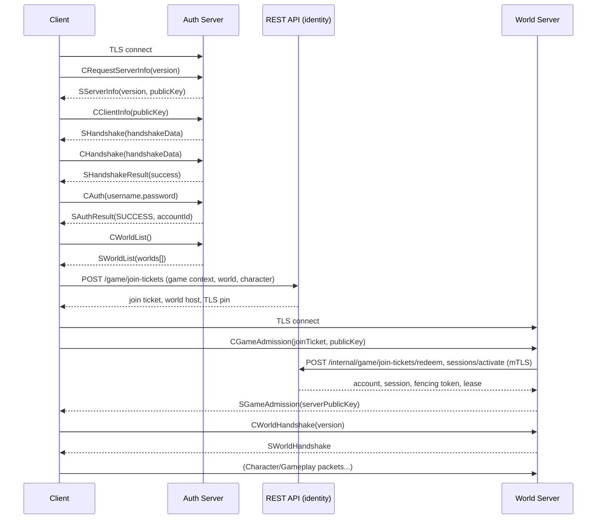

# Networking — Packet Protocol

Custom TCP layer with Protobuf-net serialization. Every client↔server message wraps a `NetworkPacket` (header + payload).

## Header Fields (`NetworkPacketHeader`)

| Field | Type | Purpose |
|---|---|---|
| `Type` (1) | `NetworkPacketType` | The opcode: which message the payload holds (e.g., `CAuthPacket` → `CMSG_AUTH`). The one field a packet is decoded and dispatched by |
| `Flags` (2) | `NetworkPacketFlags` | Bitmask: `None` 0, `ClearText` 1, `Handshake` 2, `Encrypted` 4. Only `Encrypted` is read: the payload is sealed with the session keys (below) |
| `Protocol` (3) | `NetworkProtocol` | `Invalid` 0, `Tcp` 1, `Udp` 2, `Both` 3. Every packet is sent as `Tcp`, and nothing reads the field |
| `Version` (4) | `int` | 0 in every header that is built, and nothing reads it. The protocol is versioned in the handshakes ([Extensibility](#extensibility)) |

The number beside each field is its protobuf field number.

The header is a struct (`NetworkPacketHeader`), read by hand from each frame by `InboundPacketFrame.ParseFrame`, so
neither a received frame nor a sent packet allocates a header (#875); the wire is unchanged.

`Encrypted` is the only flag anything acts on. A receiver opens the payload with the session keys when the header
carries the flag and takes the payload as plain when it does not (`Connection`'s read loop). A flagged payload that
does not open, or that arrives before the session has keys, closes the connection
([failure modes](#failure-modes--safeguards)). A packet class declares
its flags in a static `Flags` field; the outbox seals a packet flagged `Encrypted` when its connection seals, and when
it does not, the payload goes plain and the flag is cleared from the header as the frame is written
([Sending a packet](#sending-a-packet)). A world with `Network:PacketEncryption` on closes a connection that sends
plain a packet it must seal ([World Admission](#world-admission)). `ClearText` is declared by the server-info,
client-info and game-admission packets (`CRequestServerInfoPacket`, `SServerInfoPacket`, `CClientInfoPacket`,
`CGameAdmissionPacket`, `SGameAdmissionPacket`) and by `CPingPacket`; `None` by `SPingPacket`, `SPongPacket`,
`CPongPacket` and `SDisconnectPacket`. The servers treat the two alike: neither is `Encrypted`. No packet declares `Handshake`. There is
no compression flag, and nothing compresses a payload. `schema/opcodes.json` lists the flags each packet class
declares.

Transport: TCP inside TLS, one connection per phase (Auth, then World). The auth server wraps every accepted socket in
TLS 1.2 with its certificate, the world server in TLS 1.2 or 1.3 with its own (both `Hosting:Security:CertificatePath`),
and a client pins the world's leaf named in its join reply. Ordering guaranteed by TCP.  
Encryption: inside TLS, session crypto negotiated via ephemeral public key exchange during handshake stages; on the
world server the per-packet session layer is a per-world setting, `Network:PacketEncryption`, off by default (#875).  
Framing: a frame is a varint length prefix, then that many bytes: one protobuf `NetworkPacket` message, whose field 1
is the header and field 2 the payload, each length-delimited (a tag byte, a varint length, the bytes). No part has a
fixed length. The header is itself a protobuf message of four varint fields, and a field that is 0 is not written: the
header of a sealed gameplay packet takes 7 bytes (3 for the opcode, 2 for `Encrypted`, 2 for `Tcp`, none for the
version), and 5 when the same packet goes plain. `NetworkPacketHeader.Size`, a constant 10, is what the byte counters
add for a header, not its length on the wire. A frame a peer sends is limited in length
([below](#the-inbound-frame-length-limit)); a frame a server sends is not.

## The inbound frame length limit

Every frame on the wire is `[varint length][NetworkPacket{1: header, 2: payload}]`. **A frame a client sends may not
declare more than `Hosting:MaxInboundFrameSize` bytes (16,384 by default), on the auth server and on a world server
alike.** The length counted is the one the prefix declares: the `NetworkPacket`'s bytes, header and payload, the
payload in the form it is sent (sealed, it carries a 12-byte nonce and a 16-byte tag); the prefix itself is not
counted.

The read loop compares the prefix before it sizes anything by it (`PacketStream.EnumerateRawFramesAsync`). A frame that
declares more than the maximum, or whose prefix is not a length (a varint that runs past five bytes; a five-byte one
carries up to 35 bits and is compared as that, never narrowed first), is not buffered and not read: nothing is rented
for it, the stream ends there, and the connection is closed without a notice, as it is when a peer goes away. This
holds before admission or login as after: the prefix is the first thing any peer that completes TLS sends, and the
servers used to rent a buffer of whatever size it declared. The close writes one line at Debug (the connection, its
address and the declared length), never an exception or a stack trace, and counts one in `network.in.frame_kicks` on
the server's meter ([instrumentation](instrumentation.md#refused-frames)).

Frames the servers send are not limited by it: a chunk layout or a world-state snapshot is far larger than anything a
client sends, and a client sets its own limit on what it receives.

What a client sends against the limit (client 0.2.0, measured from its code on 2026-10-13; sizes are of the whole
frame as declared):

| Frame | Largest | What bounds it |
|---|---:|---|
| `CMSG_CHAT_MESSAGE` | about 570 bytes sealed | At most 511 bytes of UTF-8, which the world enforces (#936): the chat box takes 255, and a whisper typed after `/w Name` goes out with its prefix |
| `CMSG_GAME_ADMISSION` | about 150 bytes | A 43-character ticket and a 91-byte P-256 public key, both checked for exactly that size by the world |
| `CMSG_CHARACTER_CREATE` | about 80 bytes sealed | A name of 3 to 12 letters (`CharacterName`) |
| `CMSG_PARTY_INVITE` | about 60 bytes sealed | A character's name, 3 to 12 letters, which the world checks before any lookup (#936) |
| `CMSG_WORLD_HANDSHAKE` | about 50 bytes sealed | The client's version string |
| Every other world packet | a few tens of bytes | Numbers only: no string, byte or repeated field |
| Auth server: login, key exchange, MFA | under 200 bytes | A username of 3 to 16 characters, a password field of 64 bytes, a 91-byte key, 32 bytes of handshake data, codes of 16 characters; the client no longer dials the auth server |

So the default leaves a factor of about 28 over the largest frame a client sends, and the setting's minimum (1,024)
still admits it. No client-to-server message has a repeated field. The auth server puts no length rule of its own on the
password it is sent: for that field the frame limit is the bound.

## Sending a packet

A server packet's `Create` (`S*Packet.Create`) returns an `OutboundPacket`: its header, and its message encoded, plain,
into a pooled `PayloadSegment` by `PacketEncoder` (#875). `IConnection.Send` takes the packet's payload reference. The
connection's outbox (a world connection's send thread, the auth server's outbox as its drain task writes) seals the
payload of a packet flagged Encrypted only when the outbox seals (`IOutbox.Seals`): always on the auth server, and on
a world connection only with `Network:PacketEncryption`. Otherwise the payload goes plain inside TLS and the header
loses the Encrypted flag, so the client opens nothing. The outbox frames the packet with `PacketEnvelope`:
`[varint length][NetworkPacket{1: header, 2: payload}]`, written by hand, byte for byte what protobuf-net writes for a
`NetworkPacket`, then releases the segment to its pool: no `byte[]` per packet.

A broadcast whose bytes are the same for every recipient (a hit, a cast, a death, a heal, loot spawned or despawned,
instance and party chat, a party member's status, a maintenance warning) is encoded once, for the first recipient that
hears it, and each recipient takes a reference of its own (`OutboundPacket.Share`); the broadcaster releases its own
after the loop (#875). Each send thread copies the payload into its own connection's burst, sealing it there when its
connection seals, and releases its reference as it frames it, or at once when its connection refuses the packet; the
segment is never sealed in place, and it returns to its pool after the last reference. World-state packets
(`SInstanceStateAdd/Update/Remove`, the aura list and updates) stay per recipient: each recipient hears its own set of
units, and they are sent inside the per-recipient state pass. An aura update's bytes depend only on its unit, so sharing
it needs a per-unit cache across that pass (#898).

Nor a message object per packet. `Create` fills the calling thread's instance of its message type
(`PacketEncoder.Scratch<T>()`) and encodes it before it returns, so one instance per thread serves every packet of that
type. A resetter compiled once per type, at the world server's startup (`PacketEncoder.PrepareServerPackets`, before
the port opens), sets every field back to a new message's value on every take and again once the message is written,
so no value of one packet reaches the next or stays referenced after it. A collection comes back null (protobuf-net
writes a null repeated field as it writes an empty one), so a factory assigns each collection it sends; a nested
message the template creates is shared by every thread, so a factory assigns it whole and never writes into it. A
member the reset cannot assign (a read-only field, a property without a setter) makes the type refuse to start.
`PacketEncoderScratchShould` dirties every member of every server packet and checks that the next take comes back as a
new message, and runs every factory and checks that a new thread's scratch still encodes as a new message does.

The client-to-server packets' `C*Packet.Create`, which only clients send (the load-test tool, the benchmarks and the
tests), still build a `NetworkPacket`, sealed as it is created.

## Auth Phase Lifecycle

1. `CRequestServerInfoPacket` — client sends its version; `SServerInfoPacket` answers with the server's version and
   public key, or refuses a client below `Application:MinClientVersion` and closes.
2. `CClientInfoPacket` — client sends its ephemeral public key.
3. `SHandshakePacket` — server returns handshake data (server challenge).
4. `CHandshakePacket` — client proves possession / echoes handshake data.
5. `SHandshakeResultPacket` — indicates success and signals encryption activation.
6. `CAuthPacket` — credentials (username + password; server BCrypt verifies).
7. `SAuthResultPacket` — status (`SUCCESS`, `LOCKED`, `MFA_REQUIRED`, etc.) and `AccountId` on success; with
   `MFA_REQUIRED`, an MFA hash that `CMFAVerifyPacket` sends back with the code.
8. `CWorldListPacket` — client requests accessible world list.
9. `SWorldListPacket` — worlds filtered by account access level, each with its derived status.

The auth phase ends there: the TCP world select and world-key handoff were retired with the TLS join-ticket admission,
and their opcodes are unassigned. [Auth server login flow](auth-server.md) has the rules of each step.

## World Admission

10. The client gets a join ticket from the REST API (`POST /game/join-tickets`, against its game context), bound to one
    world, character and world server, for at most 30 seconds.
11. Client opens a TCP connection to that world server and completes TLS.
12. `CGameAdmissionPacket(JoinTicket, PublicKey)` — clear text inside TLS: the ticket and a new ephemeral public key.
13. The world server redeems the ticket and activates the session through the API's internal admission routes, off the
    tick, then initializes the session crypto. The key exchange runs for every connection, whatever the world's mode, so
    a client that always seals keeps working (retiring it is #878).
14. `SGameAdmissionPacket(PublicKey, Result, PacketEncryption)` — `Accepted` with the server's public key and the
    world's mode (field 3, `Network:PacketEncryption`, #875): true, the client seals every gameplay packet it sends;
    false, TLS alone and it sends plain. The client seals exactly as told. Otherwise `InvalidRequest`,
    `AuthorizationRequired` or `ServiceUnavailable` (`UnsupportedClient` is declared beside them; this server refuses
    an old client at step 15 instead), `PacketEncryption` false, and the connection is closed.
15. `CWorldHandshakePacket(Version)` / `SWorldHandshakePacket` — sealed only when the world seals; the client's version
    must be at least 0.3.0 and the world's `MinVersion`, or the connection is closed.
16. Subsequent packets (character list, selection, movement, chat) proceed under the admitted session. A connection
    keeps the mode it was created and admitted under for its life; a change of the setting needs a restart.

Strictness of the mode (#875). With `Network:PacketEncryption` on, a plain packet the world runs (the version
handshake, and every packet a session filter names but the pong) closes the connection as a protocol violation, at
arrival, before any filter is asked (`WorldConnection.OnReceive`). Admission and pong are plain by design and accepted
plain. An opcode no world filter takes is dropped as before, whatever its flags. With the flag off, plain and sealed
are both accepted.

Compatibility of the mode (#875). A server opens a client packet by its header, sealed or not; a client opens a server
packet by its header too.

| Client | Server | Client to server | Server to client |
|---|---|---|---|
| before #875 | flag off | the client still seals; the server opens it by its header | plain; the client follows the header |
| before #875 | flag on | sealed, as before | sealed, as before |
| current | flag off | plain | plain |
| current | flag on | sealed | sealed |
| current | before #875 (field absent, reads false) | plain; that server decides by the header | sealed; the client follows the header |

## Time Sync: `SMSG_PING` and `CMSG_PONG`

The world server's tick queues a ping for every connection in its list once every 600 ticks (about ten seconds, each
connection on the tick its place in the list gives it), whether or not the connection has been admitted yet, and one
more right after a connection's version handshake. The client answers each ping with one pong. From the exchange the
server measures the connection's round trip (`IWorldConnection.RoundTripTime` in ticks, `Latency` in whole
milliseconds) and the offset between the two clocks, and tells the client both on the next ping. The character row
and the REST API carry `Latency` as of character select (`CharacterSelectHandler` copies it once): often the
handshake ping's reading, or 0. Both packets are plain inside TLS, whatever `Network:PacketEncryption` says. Every
time is in UTC ticks (100 ns, counted from year 1).

| Packet | Field | Meaning |
|---|---|---|
| `SPingPacket` | `ServerTimestamp` (1) | Server time as the connection's send thread wrote the ping (#875). It also names the ping |
| | `ClientTimestamp` (2) | The `ClientReceivedTimestamp` of the last pong the server accepted |
| | `Rtt` (3) | The last round trip the server measured |
| | `Offset` (4) | Server time minus client time, from that same exchange |
| `CPongPacket` | `LastServerTimestamp` (1) | The `ServerTimestamp` of the ping it answers, echoed exactly |
| | `ClientReceivedTimestamp` (2) | When the client received the ping, on its own clock |
| | `ClientSentTimestamp` (3) | When the client sent the pong. Still on the wire; the server does not read it |

**The server measures the round trip alone (#892).** Before, the round trip was computed from the echo and the client's
receive and send times, so a client could report any round trip it liked, zero and negative ones included. Now:

- The send thread records the stamp of each ping as it writes it, before the ping can reach the client. It keeps the
  stamps of the last four pings it wrote (`ConnectionSender.PingStampCapacity`), each until a pong answers it. A
  connection has one ping unanswered at a time, two when the handshake's ping sits beside a periodic one, so a stamp
  stays answerable for thirty seconds or more.
- **One pong per ping.** Each ping written grants the connection one pong credit, never more than four at once. A pong
  takes a credit as the read loop receives it, whatever it echoes, and a pong that finds none is dropped there
  (`WorldConnection.OnReceive`), before it is queued for the tick. The check comes after the admission check, so a pong
  sent before admission is dropped as it always was and spends nothing: the credits of the pings written before
  admission are still there after it, up to the four.
- A pong that got in is accepted only when its `LastServerTimestamp` equals one of the recorded stamps. The stamp is
  then spent. The echo plays no other part.
- `round trip = the pong's arrival - the ping's stamp`. Both are the server's own readings of its own clock: the stamp
  taken at the write, and the arrival taken by the read loop as it reads the pong off the socket, not when the tick
  handles it. `Latency` is the round trip in whole milliseconds.
- `offset = the ping's stamp + round trip / 2 - ClientReceivedTimestamp`. That is the one term of the client's left. It
  is the client's own clock by nature, and a false value moves only that client's own idea of server time.
- The next ping carries `Rtt`, `Offset` and `ClientTimestamp` from the last accepted pong. All three are 0, as are
  `Latency` and `RoundTripTime`, until the first one.

**What a client must do.** Echo `ServerTimestamp` unchanged, answer each ping once, and send no other pong: a pong
that echoes anything else uses up that ping's one answer, and the true echo sent after it is dropped. Answer as it
reads the ping: the time between receiving a ping and sending its pong is part of the round trip (it used to be
subtracted), and half of it lands in `Offset`. Fill `ClientReceivedTimestamp` from the clock it applies `Offset` to.
After a stall in which pings went unanswered, answer only the newest ones, at most four, and drop the rest: the server
remembers the last four stamps and lets at most four pongs in, whatever they echo, so an answer to an older ping
takes the place of an answer to a newer one.

**What the server drops and ignores.** In every case below `Latency`, `RoundTripTime` and the offset stay as they
were, the next ping repeats the old `Rtt` and `Offset`, and the connection stays open. No metric counts any of them.

- *Dropped as it arrives*: a pong beyond one per ping written (a second answer, a burst, a pong before any ping). It is
  never queued and no handler runs. Logged at Trace only (`Avalon.World.WorldConnection`), since a client can send
  them at any rate. This also catches a client that stalls past four pings and then answers them all, oldest first:
  its first pongs spend the four credits on pings the record has forgotten, and the answers to its newest pings are
  dropped. With five unanswered, the newest ping's answer is the one dropped and the reading left is the one before
  it, stretched by the stall; with eight, all four pongs let in answer forgotten pings and nothing is measured. The
  next ping measures again.
- *Let in, then ignored by the handler*: a pong whose echo is the stamp of no unanswered ping (a forged or guessed
  one, the echo of a ping already answered, or of a ping that four later pings have pushed out of the record). Logged
  at Debug, at most once per ping written.
- *Let in, matched, then ignored*: a pong whose arrival reads earlier than the stamp it echoes. Either the echo was
  sent ahead of its ping (a guess that hit) or the server's clock was set back in between. The stamp is spent, nothing
  is measured, and the round trip is never negative. Logged at Debug.

**What the measurement does not prove: `Latency` is advisory, in both directions.**

- *Guessing the stamp.* The echo is a reading of the server's clock, not a secret. A client sees every earlier
  `ServerTimestamp` and the pings follow the tick's deadlines, so it can predict the next stamp to within about 0.1 to
  2 ms: 1,000 to 20,000 candidate values at 100 ns. A pong carrying the right one, arriving just after the ping is
  written and before the client could have read it, reads a round trip shorter than the client's own. The credit
  leaves it one guess per ping against those thousands of candidates (up to four at once after letting pings go
  unanswered), where it used to have as many as it could send. That lowers the odds and does not close guessing. A
  ping identifier the client cannot predict would close it, and is a wire change.
- *Answering late* raises the reading. How long a stamp stays answerable follows from the cadence alone (until four
  later pings are written, some forty seconds at one ping per ten seconds). Nothing in the code caps the round trip.
- *The reading has no age.* A client that stops answering keeps its last reading, and one that never answers reads 0.

Code that would trust latency (lag compensation, cheat heuristics, matchmaking) needs more than this. An age for the
reading and a ping identifier the client cannot predict would close staleness and guessing, and no more. A client could
still raise its reading at will, so a use that a high reading benefits also needs a bound on readings. And what would
be left is only a floor: the reading would be no lower than the real round trip to the connection's endpoint, which is
whatever terminates its TLS (a proxy or a relay as well as a player's machine), not to the player.

## Redis Usage in Flow

- `auth:account:{accountId}:mfa` and `auth:mfa:hash:{sha256}` — the MFA step's state.
- `game-auth:{environment}:join-ticket:{digest}` — a join ticket, stored by its digest, redeemed once.
- `auth:accounts:online` / `world:accounts:disconnect` — pub/sub channels for cross-component presence coordination.

See [Redis Cache Keys](redis-cache-keys.md) for the full key reference.

## Failure Modes & Safeguards

- Invalid handshake data → connection closed (avoid resource waste).
- Wrong key size → rejected prior to crypto init.
- A malformed, expired, spent or foreign join ticket → `SGameAdmissionPacket` refusal and the connection closed; a
  world connection that is not admitted within 15 seconds is closed.
- Multiple logins for same account → previously connected session force-disconnected via pub/sub event.
- A frame that declares more than `Hosting:MaxInboundFrameSize` bytes, or a malformed length prefix, on either server →
  nothing is buffered for it and the connection is closed without a notice ([above](#the-inbound-frame-length-limit)).
- A frame that is not a `NetworkPacket`, a payload flagged `Encrypted` that arrives before the session has its keys or
  does not open under them, or a payload that is not an encoding of its opcode's packet (one that nests more than 32
  messages or groups deep included), on either server → the
  connection is closed without a notice, as a protocol violation: one Warning without the exception, and one count in
  `network.in.protocol_kicks` (#897, [packet handlers](packet-handlers.md)).
- An opcode the server has no packet type for → the frame is dropped and the connection stays open: an older client
  may still send an opcode a newer server has retired. The first on a connection is logged at Warning, the rest at
  Debug (#897).
- A world connection with `Network:MaxReceiveQueueDepth` packets (2,048) received and waiting for the tick that sends
  another → the packet is not queued and the connection is closed without a notice (#927,
  [packet handlers](packet-handlers.md)). The outbound mirror is the slow-connection close past
  `Network:MaxPendingBytes` (#875).

## Open Defect — a `DateTime` loses its kind

A `DateTime` sent over the protocol arrives without knowing which zone it is in, and this is a
defect in the server rather than a property of the wire format a client has to live with.

protobuf-net encodes a `DateTime` as `bcl.DateTime`, which has a `kind` field, and writes only
the value and the scale. The loss is on the writing side alone: nothing populates the field, but
the reader honours it when it is there — hand protobuf-net a `bcl.DateTime` carrying `kind = 1`
and it returns a `DateTimeKind.Utc` timestamp, `kind = 2` and it returns a local one. So a
timestamp written as `DateTimeKind.Utc` comes back from the **server's own deserializer** as
`DateTimeKind.Unspecified`, and any code that then treats it as local — `ToLocalTime`, a
comparison against `DateTime.Now`, a format without an offset — shifts it silently by the host's
offset. Nothing raises.

Affected today: the two chat timestamps, `SChatMessagePacket.DateTime` and its client
counterpart. A client cannot recover the zone either and has to be told out of band.

Either end of a fix is viable and both are protocol changes. Populating the field is the smaller
one, and it needs no reader work at all: `RuntimeTypeModel.Default.IncludeDateTimeKind = true`,
set before the model first serializes a `DateTime`, writes `kind` and the round trip then keeps
it. That adds two bytes to every `DateTime` on the wire, so it is a wire change and the corpus
moves with it. The other end is to carry the timestamp as an explicit UTC tick count or a
`google.protobuf.Timestamp` and drop `bcl.DateTime` for these members. Until one is taken, treat
every received `DateTime` as UTC by convention and never call `ToLocalTime` on one.

`WireLimitsShould.Not_Carry_The_Kind_Of_A_DateTime` holds the current behaviour with the bytes
in it, so a fix will turn that test red rather than pass unnoticed.

## Security Considerations

- Single-use join tickets mitigate replay: a ticket lives at most 30 seconds, is bound to one world server, and is
  redeemed once, by that server, over its mutually authenticated workload connection.
- Separation of the auth and world sessions limits the blast radius of a compromised session token.
- Public key re-exchange on world join prevents key reuse across phases.
- Auth failures are budgeted per source and per username ([auth server](auth-server.md)).

## Extensibility

- **Add a packet or a handler:** the recipe is in [packet handlers](packet-handlers.md), with the session filter entry
  a world game packet needs: without one the packet is dropped at arrival and its handler never runs. What identifies
  a packet is the `public static NetworkPacketType PacketType` field on its class, found by reflection at startup
  (`PacketReader`, `PacketManager`, and `tools/Avalon.Exporter` for `schema/opcodes.json`), so a new packet class
  declares a new `NetworkPacketType` value there. A packet a server receives also derives from `Packet` and carries
  `[Packet(HandleOn = ComponentType.Auth)]` or `ComponentType.World`: `HandleOn` is what gives that server a decoder
  for the opcode (`AddCoreServices`), and without it the read loop drops the frame and logs "Unknown packet type" (at
  Warning for the first on a connection, at Debug after that). A server decodes once with every packet it is the
  `HandleOn` of as it starts, so a contract protobuf-net cannot build stops that server from starting (#897). The
  attribute's `Type`
  repeats the opcode; no server code reads it (the host graph tests do). After any contract change, re-export the wire
  schema (`tools/Avalon.Exporter -- proto`, `opcodes`, `corpus`).
- **Version evolution:** there is no version per packet. `Header.Version` is always 0, and no handler is chosen by it.
  A client states its version once per connection, and a server refuses one that is too old:
  `CRequestServerInfoPacket.ClientVersion` against `Application:MinClientVersion` on the auth server (step 1 above),
  `CWorldHandshakePacket.Version` against 0.3.0 and the world's `MinVersion` on a world (step 15). Neither server
  looks at a version anywhere else. Before either, the REST game sign-in and world allocation require the client's
  protocol version to equal `GameWorkloadConfiguration.ClientProtocolVersion` (0.3.0, #948), which is what refuses a
  client from the other side of a wire change. What the
  wire is at a given commit is the generated schema: `tools/Avalon.Exporter` writes `schema/avalon.proto`,
  `schema/opcodes.json` and `schema/corpus/` from the packet contracts (the corpus from its fixtures of them),
  `WireSchemaShould` and `WireCorpusShould` fail when they are stale, and the game client vendors them. A retired opcode is deleted, and its number may be
  reused once clients have re-vendored the schema ([packet handlers](packet-handlers.md)); every other wire enum is
  append-only.
- **Compression:** there is none, and no header flag for it (see [the header](#header-fields-networkpacketheader)).

## Sequence Diagram

Flow summary:
1. Secure ephemeral key negotiation (Auth)
2. Credentials verification & session marking
3. World discovery with access filtering
4. One-time join ticket issuance (REST game admission)
5. World server redemption + second crypto establishment
6. Transition to gameplay channel
